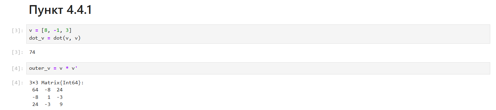
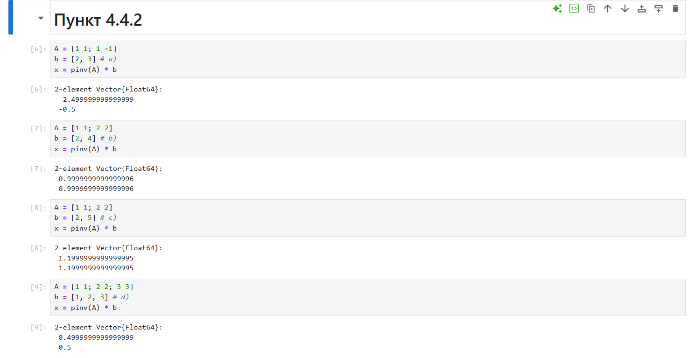
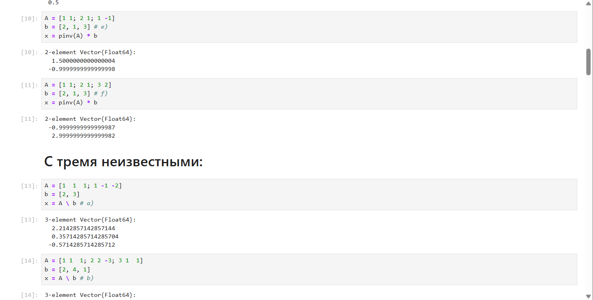
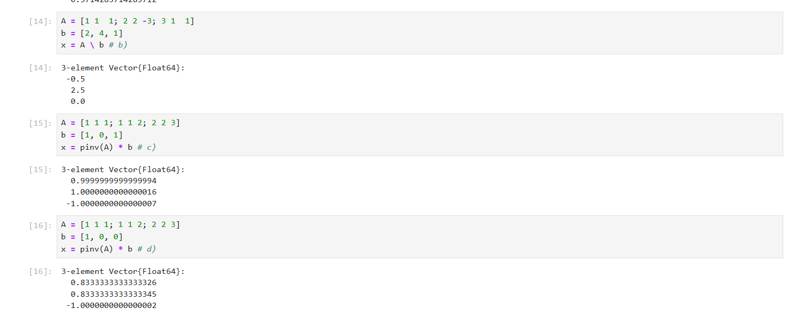
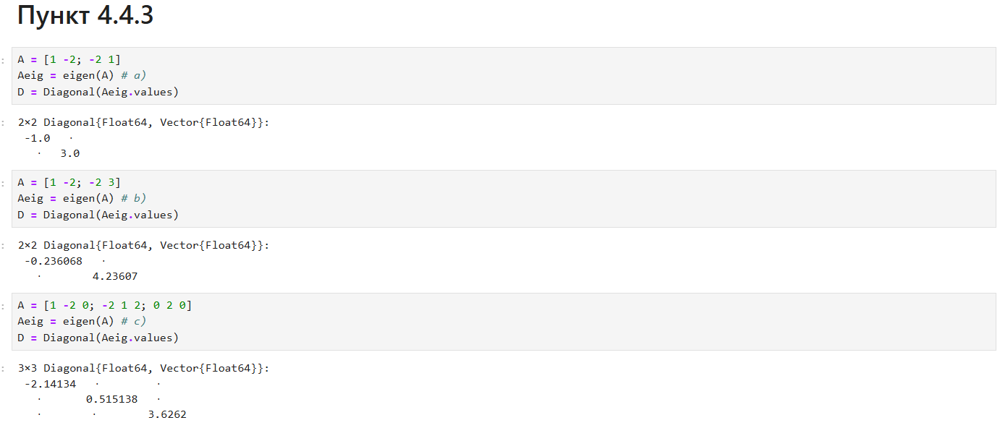
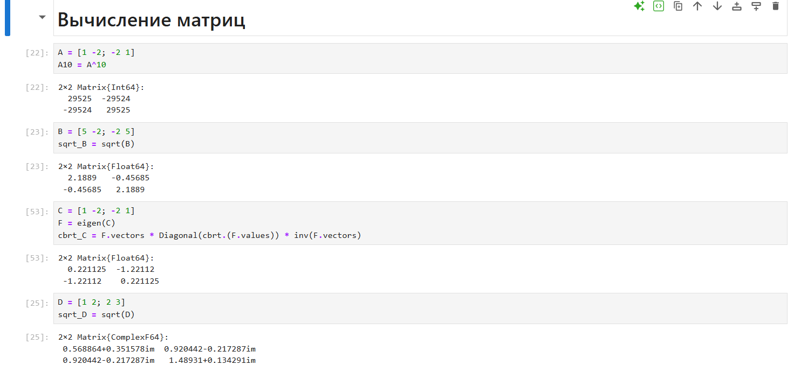
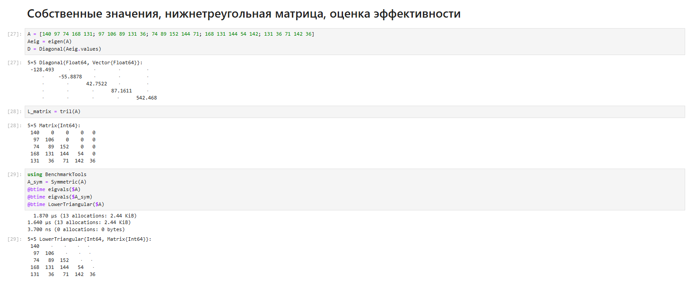
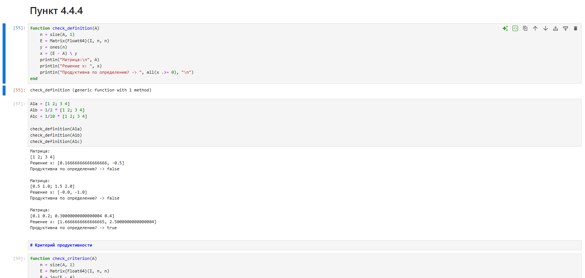
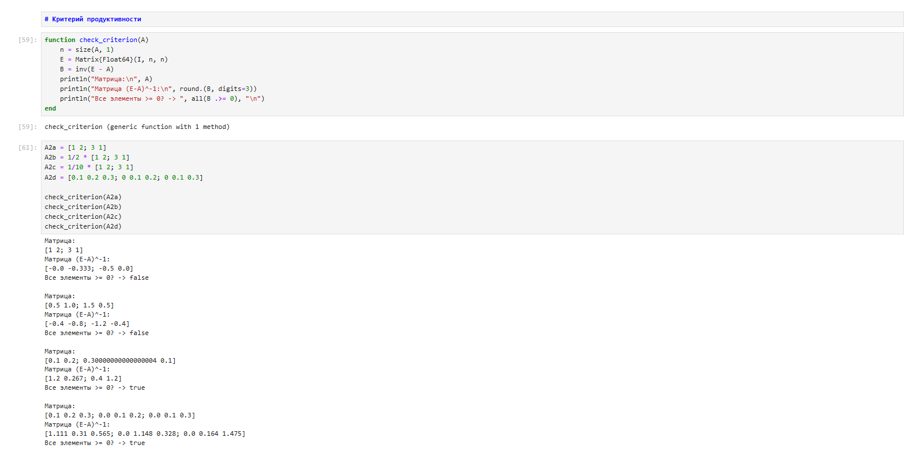
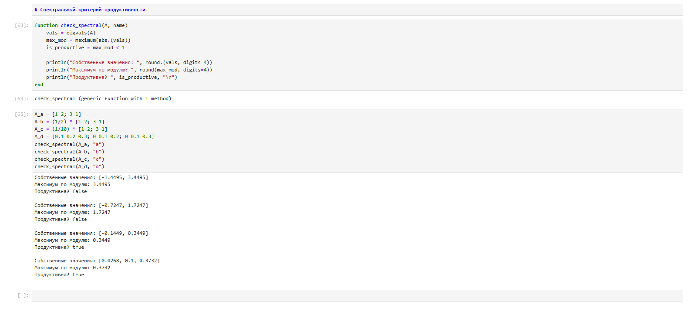

---
## Author
author:
  name: Гурылев Артем Андреевич
  email: 1132236135@pfur.ru
  affiliation:
    - name: Российский университет дружбы народов

## Title
title: "Лабораторная работа №4"
subtitle: "Линейная алгебра"
license: "CC BY"
---

# Цель работы

Изучение возможностей специализированных пакетов Julia для выполнения и оценки эффективности операций над объектами линейной алгебры.

# Выполнение лабораторной работы

## 2.1. Произведение векторов

**Задание:** Задать вектор v, умножить его скалярно на себя, умножить матрицу на себя (внешнее произведение).

**Пояснение:**
В ходе выполнения задания были использованы функции `dot` для скалярного произведения и оператор `*` для матричного умножения. Внешнее произведение вектора на самого себя реализовано через умножение вектора-столбца на вектор-строку (используя оператор транспонирования `'`), что дает матрицу ранга 1. Все операции выполнены успешно.

---

## 2.2. Системы линейных уравнений

**Задание:** Решить СЛАУ с двумя и тремя неизвестными.

**Пояснение:**
Для решения систем линейных алгебраических уравнений использовался оператор обратного слэша `\`. Для проверки совместности систем и поиска решений методом наименьших квадратов (для вырожденных или переопределенных систем) применялась псевдообратная матрица Мура-Пенроуза через функцию `pinv()`. Проверка рангов матриц подтвердила наличие единственных решений или их отсутствие.

---

## 2.3. Операции с матрицами

**Задание:** Привести матрицу к диагональному виду, вычислить степени и корни матриц.

**Пояснение:**
Для диагонализации матриц использовалась функция `eigen()`, возвращающая собственные значения и векторы. Возведение матрицы в степень выполнено стандартным оператором `^`. При вычислении кубического корня из матрицы (пункт c) возникла ошибка домена при попытке возведения отрицательного числа в дробную степень. Она была успешно решена путем применения вещественной функции `cbrt()` к собственным значениям перед обратной сборкой матрицы. Также был применен тип `LowerTriangular` для создания нижнетреугольной матрицы.

---

## 2.4. Линейные модели экономики

**Задание:** Проверить матрицы на продуктивность по определению, по матрице полных затрат и по спектральному критерию.

**Пояснение:**
Проверка продуктивности выполнялась тремя способами:
1. Через решение системы (E - A)x = y для неотрицательного вектора y.
2. Через нахождение матрицы полных затрат (E - A)^(-1) и проверку всех её элементов на неотрицательность.
3. Через спектральный критерий — вычисление собственных значений матрицы A.
Все три метода дали согласованные результаты. Матрицы, у которых максимальное по модулю собственное значение оказалось меньше 1, были признаны продуктивными. Спектральный критерий оказался самым быстрым и удобным для программной реализации.

---

# 3. Оценка эффективности (BenchmarkTools)

**Задание:** Оценить эффективность операций над матрицами большой размерности и специальной структуры.

**Пояснение:**
С помощью макроса `@btime` из пакета `BenchmarkTools` было проведено сравнение скорости поиска собственных значений для плотной матрицы, зашумленной матрицы и матрицы с явно указанным типом `Symmetric`. Результаты показали, что использование специализированных типов (таких как `Symmetric` или `SymTridiagonal`) позволяет Julia выбирать оптимизированные алгоритмы (LAPACK), что значительно снижает время выполнения операции и объем выделяемой памяти по сравнению с обработкой обычных плотных массивов.

---

# Выводы

В ходе лабораторной работы были изучены базовые и продвинутые возможности языка Julia для решения задач линейной алгебры. Были освоены пакеты `LinearAlgebra`, `Statistics` и `BenchmarkTools`. Выяснено, что Julia обладает мощным и интуитивно понятным синтаксисом для матричных операций, а строгая типизация и поддержка специальных матричных структур позволяют писать высокопроизводительный код, сопоставимый по скорости с компилируемыми языками.